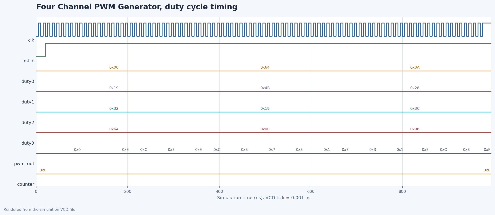

# Four-Channel PWM Generator

[](https://github.com/saiv9/Four-Channel-PWM-Generator-Verilog/actions/workflows/rtl-simulation.yml)

A four-channel pulse-width modulation generator implemented in Verilog HDL. All channels share one period counter, while each channel has an independent duty-cycle input.

## Design features

- Four independent PWM outputs
- Shared period counter
- Configurable period length
- Duty-cycle inputs from 0 to 100 percent
- Duty settings sampled at the start of each period
- Requests above 100 percent are clamped to 100 percent
- High time rounded down to a whole number of clock cycles

## Architecture


The shared counter defines the period for all four outputs. Each duty input is captured at the period boundary, so changes during a period take effect at the next period. The four outputs compare the counter against their calculated high-time values.

## Interface

| Signal | Direction | Description |
|---|---|---|
| `clk` | Input | System clock |
| `rst_n` | Input | Asynchronous active-low reset |
| `duty0` to `duty3` | Input | Requested duty cycle from 0 to 100 |
| `pwm_out[3:0]` | Output | Four PWM signals |

### Parameter

| Parameter | Default | Description |
|---|---:|---|
| `PERIOD_CYCLES` | 1000 | Number of system-clock cycles in one PWM period; minimum 2 |

## Run the simulation

Install Icarus Verilog and Python with Matplotlib. From the repository root, run:

```bash
bash scripts/run_sim.sh
```

The testbench uses a 16-cycle period and checks all four outputs at each position. It also checks period-boundary updates, duty-cycle rounding, and clamping of an input above 100 percent. The current testbench reports 80 period-position checks.

## Simulation output



[Open the VCD waveform](docs/waveforms/pwm_generator.vcd) · [View the simulation log](docs/waveforms/simulation.log)

GitHub Actions runs the same testbench and uploads the waveform and log.

## Scope

This version uses edge-aligned PWM. It does not include complementary outputs, dead-time insertion, centre-aligned PWM, or a hardware power stage. Verification is simulation-based; no physical FPGA board test is claimed.

## License

MIT. See [LICENSE](LICENSE).
